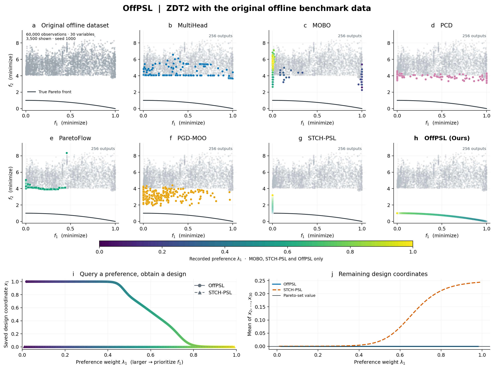

<div align="center">

# OffPSL

### Conservative Pareto Set Amortization<br>for Offline Multi-Objective Optimization

**NeurIPS 2026**

[Quick start](#quick-start) · [Results](docs/FIGURE.md) · [Method](docs/METHOD.md) · [Data](#use-your-own-data) · [Citation](#citation) · [Contact](mailto:jicheng9617@gmail.com)

*Learn from offline observations. Query a trade-off. Obtain a design.*

</div>

OffPSL learns a deterministic **preference → design** map from a fixed dataset of evaluated candidates. A pessimistic objective ensemble guides improvement, while a frozen multi-noise denoiser regularizes support. After training, a batch of requested preferences produces a batch of designs in one network call.

<p align="center">
  
</p>

**ZDT2: objective-space comparison and preference-to-design mapping.** Each method returns 256 candidates at seed 1000. Gray points show 3,500 of the 60,000 offline observations; the dark curve is the analytic Pareto front. All objective panels share the same axes. [Figure details](docs/FIGURE.md) · [Full-size SVG](assets/zdt2.svg)

## What is included

| Method | Offline training signal | Inference |
|:--|:--|:--|
| **OffPSL** | Ensemble mean + uncertainty penalty, smooth Tchebycheff loss, denoising support and covariance penalties, optional diversity | Deterministic preference-to-design map |
| **STCH-PSL (offline adaptation)** | One fitted objective surrogate and smooth Tchebycheff loss | Deterministic preference-to-design map |

The STCH-PSL implementation is an independent local adaptation of [Lin et al., ICML 2024](https://proceedings.mlr.press/v235/lin24y.html), with attribution to the [original method and repository](https://github.com/Xi-L/STCH). Both methods accept plain NumPy arrays. Benchmarks, datasets, and other method implementations remain external.

## Quick start

Train both methods on a six-variable synthetic ZDT2 dataset with near-front-biased observations. The example runs locally without a dataset download. See the [example protocol](docs/EXAMPLE.md) or the [benchmark figure instructions](docs/FIGURE.md).

Use Python **3.10+**. From this repository's root:

```bash
python -m venv .venv
```

Activate with `source .venv/bin/activate` on Linux/macOS, or `.venv\Scripts\Activate.ps1` in Windows PowerShell. Then:

```bash
python -m pip install -e ".[demo]"
python examples/zdt2.py --seed 42 --device cpu --threads 2 --out runs/zdt2-seed42
```

This command generates the offline arrays, trains both methods from scratch, evaluates their final designs, and writes a figure, checkpoints, candidate arrays, and a JSON run report. **No data download, API key, GPU, or existing checkpoint is needed.** Training took approximately **30 seconds** in the recorded CPU run; hardware and library versions affect runtime. See the [recorded environment and stage timings](assets/synthetic_demo_run.json).

Open `runs/zdt2-seed42/zdt2.png` for the figure. To redraw an existing run without retraining:

```bash
python examples/zdt2.py --plot-only --out runs/zdt2-seed42
```

Use a new output directory for each training run. Core-only installation is `python -m pip install -e .`; plotting is an optional extra. For GPU training, install a suitable [PyTorch build](https://pytorch.org/get-started/locally/) and pass `--device cuda`.

## Use your own data

The method interface uses **continuous design vectors** and **minimization objectives**:

| Array | Shape | Meaning |
|:--|:--|:--|
| `X` | `(N, D)` | Offline designs, in original units |
| `Y` | `(N, M)` | Their observed objectives, in original units; `M >= 2` |
| `lower`, `upper` | `(D,)`, optional | Legal design bounds; both must be supplied together |

All arrays must be finite. If bounds are omitted, the observed coordinate-wise range is used. Convert maximization objectives to minimization before training, and reverse that transformation when interpreting predictions. Categorical encodings, domain-specific decoding, and non-box constraints belong in your task adapter.

```python
import numpy as np

X = np.load("my-designs.npy", allow_pickle=False)
Y = np.load("my-objectives.npy", allow_pickle=False)
np.savez_compressed("my-data.npz", X=X, Y=Y)
# Optional: add lower=lower_bounds, upper=upper_bounds to the NPZ.
```

### Train and query

```bash
python -m offpsl train --data my-data.npz --method offpsl --config configs/zdt2.json --seed 42 --out runs/my-offpsl
python -m offpsl predict --checkpoint runs/my-offpsl/model.pt --count 101 --out runs/my-offpsl/candidates.npz
```

For STCH-PSL, change `--method offpsl` to `--method stch-psl` and use another output directory. All training lengths in the config are **optimizer steps**, not epochs. The example config is a starting point for your data, not a universal benchmark setting.

To request specific trade-offs, save simplex rows and pass `--preferences`:

```python
import numpy as np
np.save("preferences.npy", np.array([[0.2, 0.8], [0.5, 0.5], [0.8, 0.2]], dtype=np.float32))
```

```bash
python -m offpsl predict --checkpoint runs/my-offpsl/model.pt --preferences preferences.npy --out runs/my-offpsl/queries.npz
```

A larger weight emphasizes that objective in the scalarization; it does not prescribe an objective ratio or arc-length location. Automatic queries use an evenly spaced two-objective preference grid or a seeded Dirichlet sample for more objectives. User-specified preferences are preserved exactly.

### Python API

```python
import numpy as np
from offpsl import Config, OfflineData, fit, load

data = OfflineData.from_npz("my-data.npz")
model = fit(data, Config(), method="offpsl", seed=42, device="cpu")
model.save("model.pt")
model = load("model.pt")
result = model.predict(np.array([[0.2, 0.8], [0.8, 0.2]], dtype=np.float32))
designs = result["X"]
```

### Outputs

| File / key | Contents |
|:--|:--|
| `model.pt` | Map, surrogate, OffPSL denoiser, normalization, bounds, config, and run report |
| `training.json` | Configuration, seed, stage times, sparse training diagnostics, library versions |
| Candidate `X` / `X_raw` | Feasible designs / designs before final box projection, in original units |
| Candidate `preferences` | The exact query rows corresponding to designs |
| Candidate `Y_pred` / `Y_std` | Surrogate mean / ensemble disagreement, in original objective units |
| Demo-only `Y_true` | Actual analytic ZDT2 evaluations, computed after training |

`Y_pred` is a prediction, and `Y_std` is an uncalibrated disagreement measure. The single-surrogate STCH-PSL adaptation returns zero `Y_std`. Evaluate generated designs with your own task oracle when true outcomes are required. Inference needs neither the original dataset nor benchmark imports.

## How OffPSL works

1. **Fit offline models.** Normalize designs by dataset mean/std and objectives by dataset min/max. Fit independently bootstrapped objective regressors and a noise-conditioned denoising autoencoder on the fixed arrays.
2. **Freeze them; train the map.** Sample preferences and differentiate the conservative smooth Tchebycheff objective and multi-noise support penalties through the frozen models. Only map parameters are updated at this stage.
3. **Query designs.** Evaluate the preference map and apply the configured box constraints. The default map uses bounded outputs; an unbounded training map with inference projection is also supported.

The [method notes](docs/METHOD.md) describe the denoiser, optimizer-step schedule, bootstrap ensemble, and normalization. The theoretical analysis establishes **conditional scalarized regret** and **small-noise support-distance consistency** under the assumptions stated in the paper.

## External benchmarks and data

[Off-MOO-Bench / offline-moo](https://github.com/lamda-bbo/offline-moo) supplies the benchmark and datasets used by the research project. Obtain it separately, outside this repository:

```bash
git clone https://github.com/lamda-bbo/offline-moo.git ../offline-moo
```

Follow the upstream [installation instructions](https://github.com/lamda-bbo/offline-moo#benchmark-installation) and [dataset download instructions](https://github.com/lamda-bbo/offline-moo#data-downloading). Keep its task-specific dependencies in a separate environment. Export a task's observed arrays to the NPZ interface above, train here, then evaluate candidate `X` in the benchmark environment.

For a locally downloaded continuous ZDT2 dataset, for example:

```python
from pathlib import Path
import numpy as np

task = Path("../offline-moo/data/zdt2")  # Adjust to your upstream data location.
X = np.load(task / "zdt2-x-0.npy", allow_pickle=False)
Y = np.load(task / "zdt2-y-0.npy", allow_pickle=False)
np.savez_compressed("zdt2-offline.npz", X=X, Y=Y,
                    lower=np.zeros(X.shape[1]), upper=np.ones(X.shape[1]))
```

Only pass observed training data to the learner. Keep test sets, oracle evaluations, and benchmark metrics in the external evaluation workflow. No benchmark source or downloaded data is bundled here.

## Repository map

```text
src/offpsl/       Models, losses, offline training, checkpoint inference, CLI
configs/         Explicit runnable configuration
examples/        Self-contained ZDT2 data generation, evaluation, and plotting
assets/          Generated README figure and compact reproducibility record
docs/            Method details, example protocol, and source attribution
tests/           Formula, gradients, feasibility, validation, and reload checks
```

Run the checks with `python -m unittest discover -s tests -v`. See [source and implementation provenance](docs/PROVENANCE.md) for the release boundary and STCH-PSL adaptation details.

## Citation

```bibtex
@inproceedings{offpsl2026,
  title     = {Conservative Pareto Set Amortization for Offline Multi-Objective Optimization},
  booktitle = {Advances in Neural Information Processing Systems (NeurIPS)},
  year      = {2026}
}
```

We thank the authors of [Smooth Tchebycheff Scalarization](https://proceedings.mlr.press/v235/lin24y.html) for their work and [open-source implementation](https://github.com/Xi-L/STCH).

## License

[MIT](LICENSE) for this repository's independent implementation. External projects and datasets retain their own terms and attribution.
